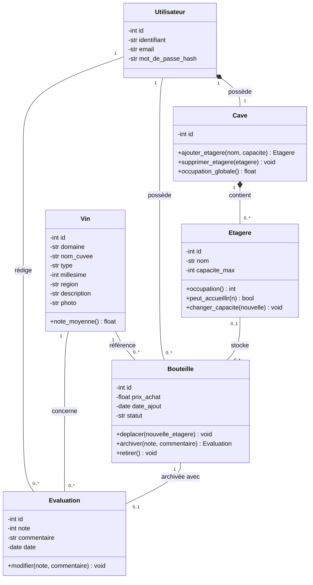

# Cavissimo

Projet de gestion collaborative d’une cave à vin, réalisé dans le cadre du module ETRS711 de Master Informatique.

L’objectif est de développer une application web Python exécutée localement : chaque utilisateur gère sa cave privée, tandis que le catalogue des vins et les évaluations de dégustation sont partagés.

## État du projet

Le dépôt contient actuellement une première conception UML et une maquette statique de l’interface.

- Diagramme de classes disponible aux formats PlantUML et draw.io.
- Maquette HTML/CSS/JavaScript avec écran de chargement animé et barre de navigation.
- Pages de gestion, code métier Python, authentification et base de données à développer.

La maquette affiche un contenu de démonstration. Les liens de navigation ne donnent pas encore accès à des pages fonctionnelles.

## Consulter la maquette

Ouvrir directement `mockup/index.html` dans un navigateur, ou lancer un serveur local depuis la racine du dépôt avec Python 3 :

```powershell
python -m http.server 5500 --bind 127.0.0.1 --directory mockup
```

Puis ouvrir [http://127.0.0.1:5500](http://127.0.0.1:5500). Pour arrêter le serveur, utiliser `Ctrl+C` dans le terminal.

Aucun paquet Python supplémentaire n’est nécessaire pour cette prévisualisation. Les polices Google Fonts nécessitent une connexion Internet ; des polices de remplacement sont prévues dans le CSS.

## Organisation du dépôt

```text
Cavissimo/
├── docs/
│   └── uml/
│       ├── diagramme_classes.drawio
│       └── diagramme_classes.puml
└── mockup/
    ├── css/style.css
    ├── js/main.js
    └── index.html
```

## Diagramme de classes UML

Ce diagramme reprend le modèle de conception du dépôt. Les classes Python restent à implémenter.



### Comment lire le diagramme

- `1` : exactement un ; `0..1` : zéro ou un ; `0..*` : zéro à plusieurs.
- Le losange plein (`*--`) représente une composition : une cave appartient à un utilisateur et une étagère appartient à une cave.
- `-` indique un attribut privé ; `+` indique une méthode publique.
- Chaque bouteille possède un seul propriétaire et correspond à une seule référence de vin. Cinq exemplaires identiques correspondent donc à cinq objets `Bouteille` liés au même objet `Vin`.
- Une bouteille en stock est placée sur une étagère. Une bouteille archivée n’occupe plus de place : l’association à l’étagère est donc facultative dans le modèle.
- Une bouteille peut être liée à une seule évaluation au maximum. Chaque évaluation concerne une bouteille archivée, un auteur et un vin ; son auteur doit être le propriétaire de la bouteille, et le vin doit correspondre à celui de la bouteille.

Les multiplicités ne suffisent pas à exprimer toutes les règles métier : les noms d’étagères doivent être uniques par cave, les capacités respectées et les déplacements limités aux étagères du propriétaire. L’archivage doit libérer la place et empêcher un second archivage. Les notes sont comprises entre 0 et 20 ; sans évaluation, la moyenne doit être affichée comme « Non évalué ».

Sources éditables : [PlantUML](docs/uml/diagramme_classes.puml) et [draw.io](docs/uml/diagramme_classes.drawio). Toute évolution du modèle devra être reportée dans ces fichiers et dans ce diagramme.

## Modèle prévu

Le diagramme distingue six concepts :

- **Utilisateur** : compte et propriétaire d’une cave.
- **Cave** : ensemble des étagères d’un utilisateur.
- **Etagere** : emplacement de stockage avec une capacité maximale.
- **Vin** : référence commune du catalogue.
- **Bouteille** : exemplaire physique d’un vin, avec son propriétaire, son emplacement, son prix et son statut.
- **Evaluation** : note et commentaire associés à une bouteille dégustée.

Un même vin peut correspondre à plusieurs bouteilles. Le stock et les prix d’achat sont privés ; les évaluations sont consultables par les utilisateurs authentifiés.

## Suite du développement

La pile envisagée est Python 3, Flask, SQLite et Jinja2, en complément de HTML, CSS et JavaScript.

- Implémenter les classes et les règles métier : capacité des étagères, déplacement, retrait et archivage des bouteilles.
- Créer le modèle relationnel et gérer les transactions pour éviter les opérations partielles.
- Ajouter les comptes, les sessions et les contrôles d’accès côté serveur.
- Relier l’interface à la gestion du stock, au catalogue et aux dégustations.
- Ajouter la recherche, les filtres, les tris et les indicateurs du tableau de bord.
- Compléter l’UML avec les cas d’utilisation et au moins un diagramme de séquence.
- Ajouter les tests et un jeu de démonstration comprenant au moins deux utilisateurs.

## Tests et installation de l’application

Il n’y a pas encore de tests automatisés, de fichier de dépendances ni de base à initialiser. Les commandes d’installation, d’initialisation et de test seront documentées avec l’implémentation Python.

