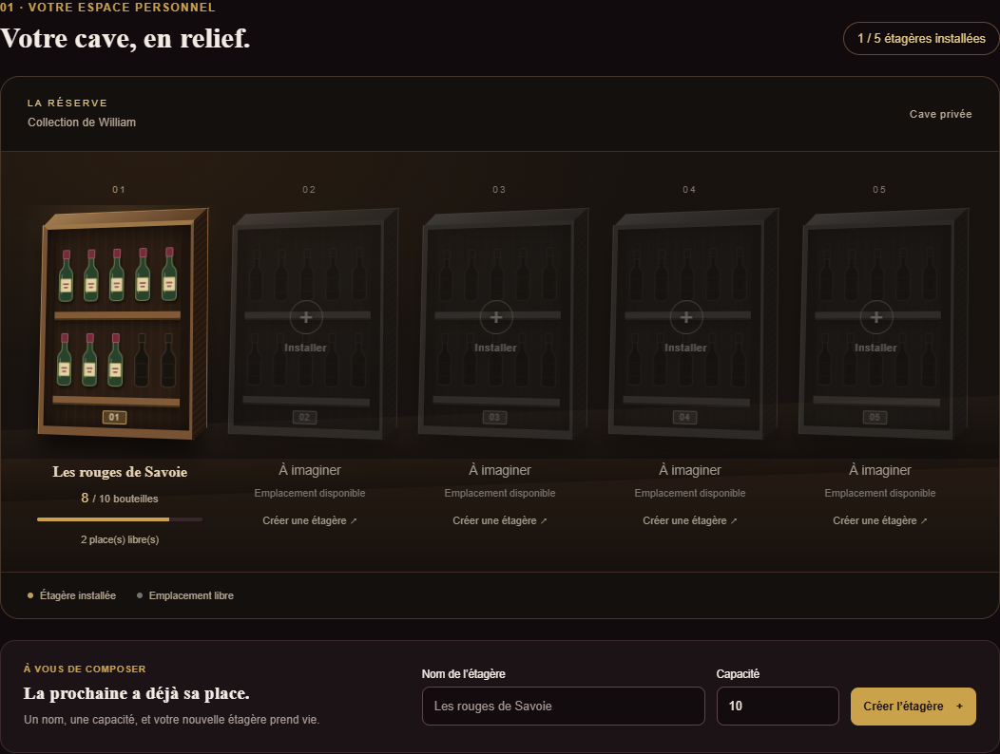
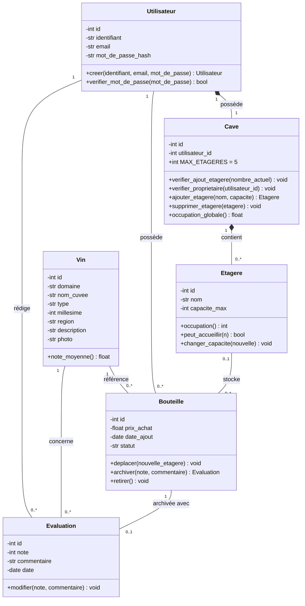

# Cavissimo

Application web de gestion d’une cave à vin, réalisée dans le cadre du module ETRS711 de Master Informatique. Le projet utilise Python, Flask et SQLite et s’exécute localement.

Chaque utilisateur possède une cave privée. Les références du catalogue de vins sont partagées entre les comptes connectés.

[Dépôt GitHub](https://github.com/Wiillyyy/Cavissimo)

## Aperçu



Aperçu avec des données de démonstration : une étagère contenant huit bouteilles sur dix places. Les quatre autres emplacements sont disponibles. Ces données ne sont pas créées automatiquement au lancement.

## Fonctionnalités disponibles

- Inscription, connexion et déconnexion avec création automatique d’une cave par compte.
- Stock, étagères et prix d’achat privés ; catalogue de vins commun aux utilisateurs connectés.
- Création de cinq étagères au maximum par cave, avec un nom unique dans cette cave.
- Création de références de vin et réutilisation des références existantes.
- Ajout d’un ou plusieurs exemplaires avec leur prix unitaire et leur date d’entrée.
- Contrôle de capacité : un lot est entièrement ajouté ou entièrement refusé.
- Consultation de chaque bouteille physique, des étagères et du catalogue.
- Tableau de bord : bouteilles en stock, références distinctes en stock, nombre d’étagères, occupation globale et valeur du stock.
- Conservation des données dans une base SQLite locale.

Le projet est encore en développement. Les fonctionnalités restantes sont listées à la fin de ce document.

## Installation et lancement

Prérequis : Python 3.10 ou supérieur et un navigateur récent.

Depuis la racine du dépôt, dans PowerShell :

```powershell
python -m venv .venv
.\.venv\Scripts\python.exe -m pip install -r requirements.txt
.\.venv\Scripts\python.exe app.py
```

Sous Linux ou macOS :

```bash
python3 -m venv .venv
.venv/bin/python -m pip install -r requirements.txt
.venv/bin/python app.py
```

Ouvrir [http://127.0.0.1:5000](http://127.0.0.1:5000). Le serveur écoute uniquement sur la machine locale. `Ctrl+C` l’arrête.

Après une modification du code Python, arrêter puis relancer le serveur. Après une modification CSS ou JavaScript, une actualisation forcée avec `Ctrl+F5` permet de récupérer les fichiers à jour.

La seule dépendance directe est Flask ; ses dépendances incluent Jinja2 et Werkzeug. SQLite et unittest font partie de Python. Les polices Google Fonts nécessitent Internet ; des polices de remplacement sont définies pour l’affichage hors ligne.

### Première utilisation

1. Créer un compte avec un identifiant de 3 à 40 caractères, une adresse email et un mot de passe de 12 à 128 caractères. La connexion est automatique après l’inscription.
2. Créer une étagère, par exemple « Mes rouges ». Sa capacité est préremplie à 10 et peut être changée avant sa création.
3. Ajouter une référence au catalogue, ou utiliser un vin déjà présent.
4. Dans « Mes bouteilles », choisir le vin, l’étagère et un prix unitaire, puis ajouter cinq bouteilles.
5. Avec une étagère de capacité 10 occupée à 5, tenter d’ajouter six bouteilles : le lot est refusé et le stock reste à cinq.
6. Créer un second compte après déconnexion : le catalogue est visible, mais le stock et les étagères du premier compte restent privés.

Une base neuve démarre sans compte, sans étagère et sans vin. Il n’y a pas encore de commande pour charger un jeu de démonstration complet.

## Données et passage depuis la première version

La base et ses tables sont créées automatiquement dans `instance/cavissimo.sqlite3`. Le dossier `instance/` est ignoré par Git. Les données sont conservées après l’arrêt du serveur.

Pour passer depuis la version sans comptes, arrêter l’ancien serveur avant de lancer la nouvelle version. L’application crée une sauvegarde `instance/cavissimo-avant-comptes-<date-et-heure>.sqlite3`, puis migre les tables dans une transaction en conservant les identifiants, les bouteilles et les prix.

**Le premier compte créé récupère les anciennes étagères et leurs bouteilles.** Les comptes suivants démarrent avec une cave vide et partagent le catalogue existant. Cette attribution concerne uniquement les données de l’ancienne version.

Par défaut, la clé de session est générée au lancement : après un redémarrage du serveur, il faut se reconnecter et recharger les formulaires. Une clé stable peut être définie avec la variable d’environnement `CAVISSIMO_SECRET_KEY`. Elle ne doit pas être ajoutée au dépôt. La session est renouvelable avec une durée configurée de huit heures.

## Choix d’interface

La direction visuelle repose sur un fond sombre, des accents dorés et bordeaux et une représentation des étagères en bois.

- La cave affiche cinq emplacements en perspective. Les étagères créées apparaissent en bois ; les emplacements libres restent gris et mènent au formulaire de création.
- Chaque dessin comporte deux rangées de cinq silhouettes de bouteilles. Les exemplaires présents sont colorés, les places non occupées restent en contour. Au-delà de dix bouteilles, un indicateur affiche les exemplaires supplémentaires. Les compteurs et les jauges utilisent toujours le stock réel.
- La capacité est préremplie à 10, mais reste réglable. Le dessin est un aperçu et ne fixe pas la capacité réelle de stockage.
- La limite de cinq étagères est un choix du projet. La règle se trouve dans `Cave.MAX_ETAGERES` et est vérifiée côté serveur dans une transaction. D’éventuelles anciennes étagères au-delà de cette limite sont conservées et restent visibles.
- Sur mobile, la scène des étagères et le tableau des bouteilles peuvent défiler horizontalement.
- Le verre animé apparaît uniquement lors d’une actualisation de page, pendant 1,4 seconde avant son fondu. Les navigations et les connexions/déconnexions ne déclenchent pas l’animation. Elle est désactivée si le navigateur demande une réduction des animations.
- Un favicon en forme de verre à vin, un curseur doré et bordeaux sur ordinateur et une icône GitHub complètent l’interface. Les champs gardent le curseur texte.

Le relief utilise du HTML/CSS et les bouteilles sont des SVG intégrés au template. Aucun moteur 3D ni bibliothèque JavaScript supplémentaire n’est nécessaire.

## Organisation du code

```text
Cavissimo/
├── app.py                  # Routes Flask, sessions et validation des formulaires
├── models.py               # Classes et règles métier
├── database.py             # Requêtes, transactions et migration SQLite
├── requirements.txt
├── demo.py                 # Exemple d’objets en mémoire
├── test_models.py
├── test_web.py
├── test_comptes.py
├── templates/
│   ├── base.html           # Structure commune, navigation et pied de page
│   ├── connexion.html
│   ├── inscription.html
│   └── index.html          # Cave, catalogue et formulaires
├── static/
│   ├── css/
│   │   ├── style.css       # Style général
│   │   ├── cave.css        # Étagères en perspective et bouteilles
│   │   └── cursor.css
│   ├── cursors/            # Curseurs SVG
│   ├── js/main.js          # Animation de chargement et barre de navigation
│   └── favicon.svg
├── docs/
│   ├── images/cave-demo.png
│   └── uml/                # Classes et séquence de connexion
├── mockup/                 # Première maquette statique
└── instance/               # Base et sauvegardes locales, ignorées par Git
```

`mockup/index.html` conserve la première maquette comme référence. Les formulaires fonctionnels sont accessibles depuis Flask.

### Le trajet d’un formulaire

1. Le navigateur envoie les champs à une route de `app.py` avec une requête POST.
2. Flask identifie l’utilisateur connecté, contrôle le jeton du formulaire et convertit les valeurs.
3. Une fonction de `database.py` charge les données et applique les règles des classes métier.
4. SQLite valide la transaction, puis Flask redirige vers la page actualisée. Une erreur de saisie ou de règle métier est affichée à l’utilisateur.

Par exemple, `POST /bouteilles` appelle `database.ajouter_bouteilles()`. La fonction vérifie le propriétaire de l’étagère, reconstitue son stock et appelle `Etagere.peut_accueillir()`. Elle insère ensuite une ligne par bouteille. `BEGIN IMMEDIATE` couvre la vérification et les insertions pour éviter que deux ajouts simultanés utilisent les mêmes places.

### Responsabilités des classes actuelles

| Classe | Responsabilité actuelle |
| --- | --- |
| `Utilisateur` | Valider les informations du compte, créer et vérifier le hash du mot de passe. |
| `Cave` | Vérifier le propriétaire et le plafond de cinq étagères. |
| `Etagere` | Compter les bouteilles, vérifier les ajouts et refuser une capacité inférieure à l’occupation. |
| `Vin` | Décrire une référence du catalogue et valider ses informations. |
| `Bouteille` | Représenter un exemplaire avec son vin, son prix, sa date, son statut et son emplacement en mémoire. |

La méthode `Etagere.changer_capacite()` existe dans le modèle et est testée ; le formulaire de modification d’une étagère reste à développer. Les opérations persistantes sont coordonnées par `database.py`, sans dépendance aux requêtes HTTP.

## Modèle relationnel

| Table | Données et relations |
| --- | --- |
| `utilisateurs` | Identifiant unique normalisé, email et hash du mot de passe. |
| `caves` | Une cave par utilisateur, grâce à une clé étrangère unique. |
| `etageres` | Cave propriétaire, nom unique dans cette cave et capacité maximale. |
| `vins` | Domaine, cuvée, type, millésime, région et identité unique. |
| `bouteilles` | Une ligne par exemplaire, avec des liens vers le vin et l’étagère, un prix et une date d’ajout. |

Un vin est une référence ; une bouteille est un exemplaire physique. Cinq bouteilles identiques correspondent à cinq lignes de `bouteilles` liées à une seule ligne de `vins`.

L’identité d’un vin repose sur le domaine, la cuvée, le type, le millésime et la région. Les textes utilisés dans les clés sont normalisés avec `split()` et `casefold()` pour ignorer la casse et les espaces répétés. Les prix sont stockés en centimes entiers ; le total est affiché en euros. L’occupation est calculée à partir des bouteilles présentes.

## Connexion et contrôles d’accès

- Les mots de passe sont hachés avec scrypt via Werkzeug, avec un sel aléatoire. Ils ne sont jamais enregistrés en clair.
- Les requêtes SQL utilisent des paramètres `?`. Les saisies ne sont pas concaténées dans les requêtes.
- L’échec de connexion affiche toujours « Identifiant ou mot de passe incorrect ». Un hash factice est aussi vérifié pour un identifiant inconnu.
- La session est vidée et son jeton anti-CSRF est renouvelé à la connexion. Le cookie Flask est signé ; aucun mot de passe ni hash n’y est stocké.
- Flask recharge le compte dans `g.utilisateur` avant chaque page privée. Le propriétaire utilisé dans les requêtes vient de la session.
- Un ajout dans une étagère inexistante ou appartenant à un autre utilisateur retourne la même réponse 404.
- Les formulaires, y compris la déconnexion, sont protégés par un jeton anti-CSRF. Jinja2 échappe les textes affichés.
- Les cookies sont `HttpOnly` et `SameSite=Lax` ; les pages privées utilisent `Cache-Control: no-store`.

Cette version est prévue pour le serveur local HTTP. La récupération du mot de passe, la confirmation de l’email et la limitation des essais de connexion restent à développer.

## Diagrammes UML

Le diagramme ci-dessous décrit le **modèle cible complet**. `Evaluation`, l’archivage, le retrait, les déplacements, la moyenne communautaire et certaines méthodes de `Cave` restent à implémenter. Les identifiants des vins, étagères et bouteilles sont actuellement portés par les lignes SQLite, sans attribut `id` dans ces trois classes Python.



Dans ce diagramme, `1` signifie exactement un, `0..1` zéro ou un et `0..*` zéro à plusieurs. Le losange plein représente une composition. `-` indique un membre privé dans la conception UML et `+` un membre public ; en Python, un préfixe `_` reste une convention.

Sources éditables : [classes en PlantUML](docs/uml/diagramme_classes.puml), [classes pour draw.io](docs/uml/diagramme_classes.drawio) et [séquence de connexion](docs/uml/connexion.puml). Les cas d’utilisation restent à ajouter ; les diagrammes devront suivre l’implémentation finale.

## Tests et démonstration

Depuis la racine du dépôt, après installation :

```powershell
.\.venv\Scripts\python.exe -m unittest -v
.\.venv\Scripts\python.exe demo.py
```

Sous Linux ou macOS, utiliser `.venv/bin/python` à la place de `.\.venv\Scripts\python.exe`.

La suite contient **20 tests** couvrant les capacités, les exemplaires distincts, le plafond de cinq étagères, le refus des ajouts partiels, les doublons, les saisies invalides, les comptes, les sessions, l’anti-CSRF, les tentatives d’injection SQL, l’échappement HTML, l’isolation des caves, la persistance et la migration de l’ancienne base.

Les tests web utilisent des bases temporaires indépendantes de la cave personnelle. `demo.py` illustre les objets en mémoire avec une étagère de capacité 3 et quatre tentatives d’ajout : trois réussites et un refus. Il ne remplit pas la base du site.

## Fonctionnalités restantes

- Modification du profil utilisateur.
- Renommage, modification de capacité depuis le site et suppression d’une étagère vide.
- Modification des informations autorisées, déplacement et retrait d’une bouteille.
- Archivage après dégustation, historique personnel, évaluations sur 20 et commentaires.
- Consultation et modification des évaluations autorisées, calcul de la moyenne communautaire.
- Descriptions et photos des vins, recherche, filtres et tris.
- Diagramme de cas d’utilisation et mise à jour des autres diagrammes selon le code final.
- Jeu de démonstration complet avec au moins deux comptes, plusieurs étagères et vins, des exemplaires identiques et des évaluations.
- Tests des fonctionnalités restantes, notamment retrait, déplacement, archivage et moyenne communautaire.
